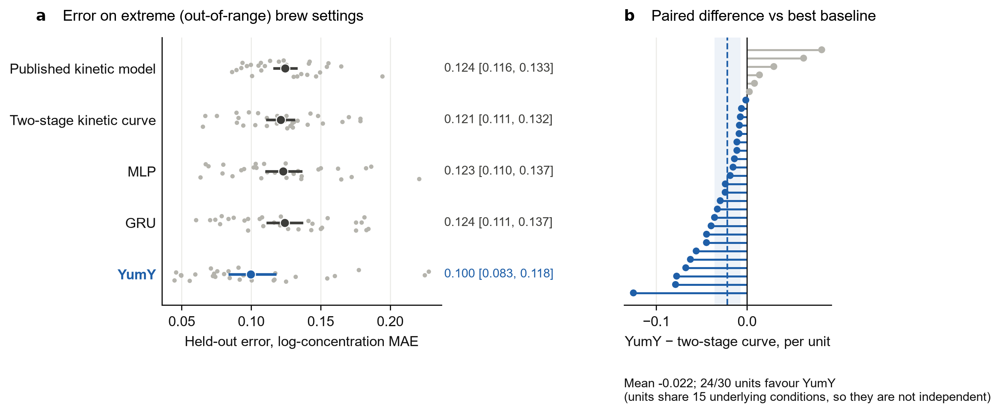
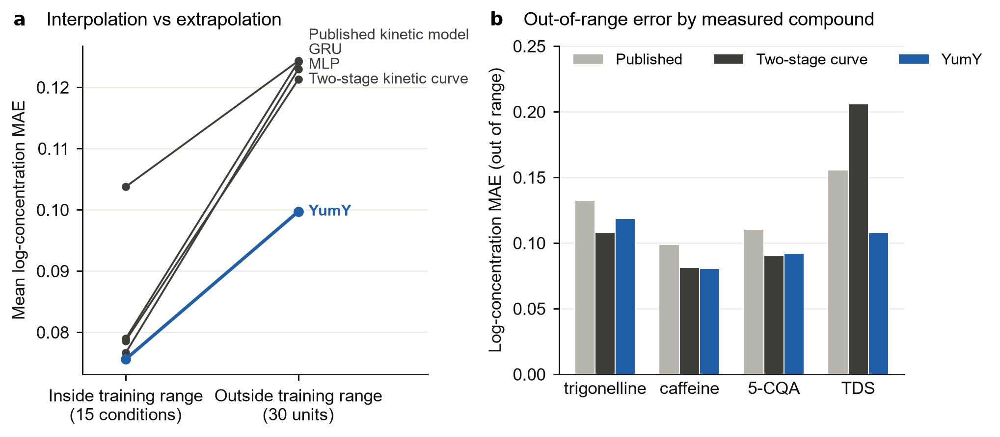
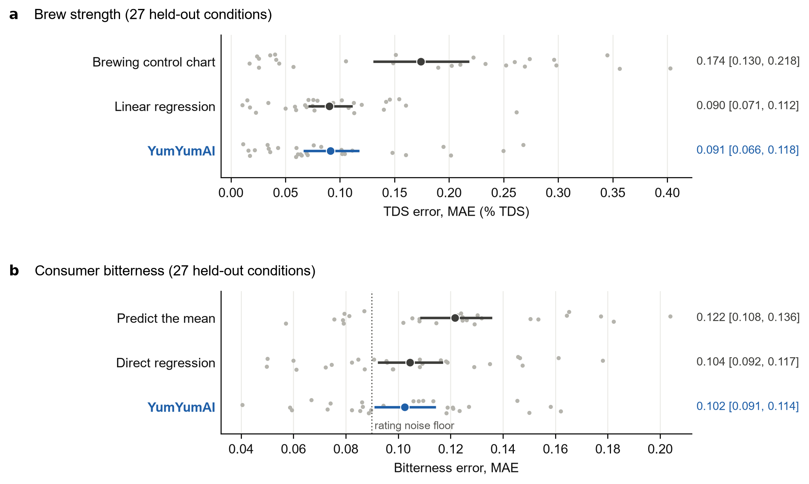

# YumYumAI: predicting how food processing changes flavor

I'm building a model that predicts how cooking and processing change a food's chemistry and, eventually, its taste.

This repository shows results and evaluation code only. The model is private.

## Headline result: generalizing to unseen brewing conditions (espresso)

Data: Angeloni et al. 2023, *Foods* 12:2871 (CC BY 4.0). It contains 48 espresso shots under 15 brewing conditions
(water flow × grind size × temperature). Trigonelline, caffeine, chlorogenic acid (5-CQA) and total dissolved solids
were measured in successive fractions of each shot. The task is to predict the concentration in every fraction from
the brew settings.

**Hardest test:** hold out every shot at an extreme setting (lowest or highest flow, grind or temperature). The test
conditions then lie outside the range seen in training. This gives 6 folds and 30 held-out condition units, with 6
seeds and a configuration fixed before seeing results.



*Figure 1. (a) Error on held-out extreme brew settings. Grey points are individual held-out units (30); dots and bars
are the mean and 95% bootstrap CI over units. (b) Per-unit paired difference against the best baseline; blue units
favour YumYumAI. Shaded band: 95% bootstrap CI of the mean difference. Units share underlying conditions, so these
intervals are approximate and likely too narrow.*

| Model | Error on unseen settings (log-concentration MAE, lower is better) |
|---|---|
| Published single-exponential model (Angeloni et al.) | .124 |
| Two-stage kinetic curve | .121 |
| Generic neural net (MLP) | .123 |
| Generic sequence model (GRU) | .124 |
| **YumYumAI** | **.100** |

- YumYumAI beats the best alternative on **24 of 30** held-out units. The 30 units are built from only 15
  underlying conditions (one condition can sit at the extreme of several factors), so they are not independent and we
  do not report a p-value for this comparison.
- On total dissolved solids the error drops by about half (.108 vs .206 for the two-stage curve).

On conditions *inside* the training range, every flexible model (including ours) ties at about .076–.079. Being
accurate within range isn't the hard part. The difference appears when conditions are new.



*Figure 2. (a) Mean error on held-out conditions inside vs outside the training range. (b) Out-of-range error by
compound. The gain is concentrated in TDS; on trigonelline and 5-CQA the two-stage curve is slightly better.*

## Second result: drip coffee strength and bitterness

Data: Cotter et al., Dryad doi:10.25338/B8993H (CC0). It contains 162 drip brews under 27 conditions and 3,186
consumer taste ratings. Each whole condition is held out in turn.

- Predicted brew strength (TDS) matches a free linear regression (.091 vs .090 MAE). It beats the industry
  constant-yield brewing control chart (.174; p = .008).
- On consumer bitterness, YumYumAI ties a direct regression (.102 vs .104), both well ahead of predicting the mean (.122).



*Figure 3. Leave-one-condition-out error on 27 drip-coffee conditions (points: conditions; bars: 95% bootstrap CI).
Dotted line in (b): approximate rating noise floor, the average error a perfect condition-level predictor would
still make because tasters disagree (in-sample estimate; individual conditions can fall below it).*

## What's in this repo

- `espresso_baselines.py`: data loader (stdlib xlsx reader, explicit missing-value handling), the published and
  two-stage kinetic curves, the generic neural baselines, held-out splits and the paired test. It reproduces every
  baseline row above:

  ```
  python espresso_baselines.py --data TableS1_ExperimentRawData.xlsx --split extrapolate --seeds 6
  ```

  Requires Python 3.12 and PyTorch. Get the data from the paper's supplementary materials; it isn't redistributed
  here.
- `charts/`: the figures above.

## Evaluation practice

- Whole conditions are held out, never individual shots from a condition the model has seen.
- Configuration is fixed before results. Every comparison uses ≥6 seeds and is paired across held-out units; p-values
  are reported only where those units are independent.
- Missing measurements stay missing and are masked out of the loss, never imputed.
- Negative and null results are reported. For example, on one USDA dataset our model was *worse* on
  ordinary held-out foods; that result shaped the next experiments.

## Next

- Multi-ingredient foods, with our own experiments now being designed.
- Trained sensory panels for taste.

## Contact

Open an issue on this repository, or reach out via the GitHub profile
[praxindice-code](https://github.com/praxindice-code), for a walkthrough or research collaboration.
